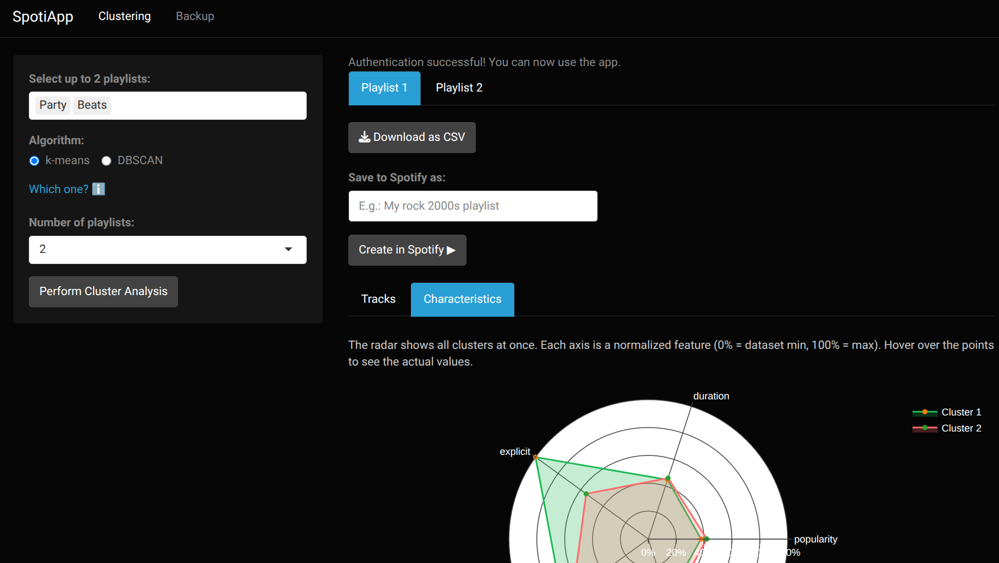
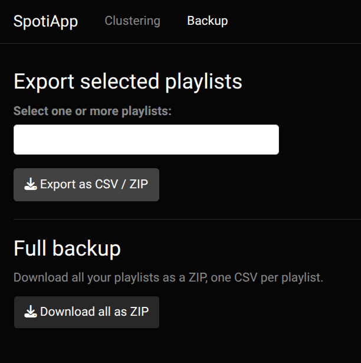

# SpotiApp

A **local** Shiny app to analyze, reorganize and back up your Spotify playlists.

## What it does

**Clustering**
- Pick up to 2 of your playlists and load their tracks
- Group them with k-means (you choose 2–4 groups) or HDBSCAN (finds the number of groups itself) using track and artist features: popularity, duration, explicitness, release year, artist popularity and genre tags
- A genre weight slider controls how much genres drive the grouping
- Browse each cluster, compare them on a radar chart, download a cluster as CSV or save it as a new private playlist



**Build**
- Pick any of your playlists as sources and build a new playlist from their tracks with filters: date added, release year, popularity, genres, artists and explicit content
- Tracks in several playlists count once, with the first date you added them
- Exclude individual tracks by hand, then save the result as a new private playlist or download it as CSV

**Organize**
- Two playlists side by side with track metadata (album, year, duration, popularity, genres, date added)
- Move or copy tracks between them. Changes stay pending (with Undo) until you confirm
- Confirm sends only the net changes to Spotify and refuses if a playlist was edited elsewhere in the meantime
- Every confirmed change is saved in a local history and can be reverted later, even after restarting the app. Tracks go back to their original positions
- If a playlist ends up empty, the app offers to delete it (reverting brings it back)

**Backup**
- Export any playlists as CSV, or all of them as a ZIP (one CSV per playlist)
- Each export also saves a local snapshot. Playlist history compares two snapshots and lists added and removed tracks



## Stack

R, Shiny + bslib, httr2 (Spotify Web API, OAuth with PKCE), dplyr/tidyr/purrr, tidyclust + dbscan, plotly, DT, DuckDB (local history), renv.

**Key decisions:**

- **No audio features endpoint**: Spotify deprecated `/v1/audio-features` (403 on apps created after ~2024). Features come from `/v1/artists` (popularity, genres) and track metadata (duration, explicit, release year).
- **Local only**: the OAuth token is cached encrypted in your user cache directory, and history lives in `spotify_app/spotiapp.duckdb`. Both stay on your machine and out of git.

## Setup

### 1. Spotify credentials

Go to [developer.spotify.com](https://developer.spotify.com/dashboard), create an app, and copy the **Client ID** and **Client Secret**. Under the app settings, add this Redirect URI:

```
http://127.0.0.1:1410/
```

Create a `.Renviron` file in the project root (use `.Renviron.example` as reference):

```
SPOTIFY_CLIENT_ID=your_client_id
SPOTIFY_CLIENT_SECRET=your_client_secret
SPOTIFY_CLIENT_REDIRECT_URI=http://127.0.0.1:1410/
```

Restart your R session after saving.

### 2. Install dependencies

Open R in the project root (renv activates on its own) and run:

```r
renv::restore()
```

The lockfile uses Posit Package Manager, so on Linux packages install as binaries.

### 3. Run the app

```r
shiny::runApp("spotify_app")
```

The app opens at `http://127.0.0.1:3838`. Click **Log in with Spotify** (top right); the first time, a browser window asks you to authorize the app.
